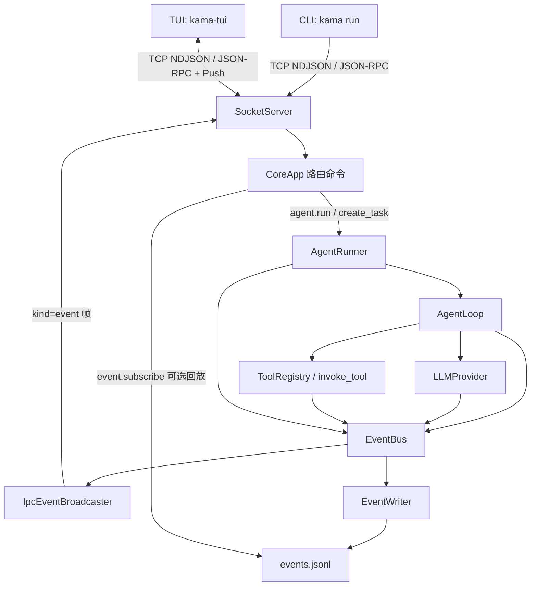
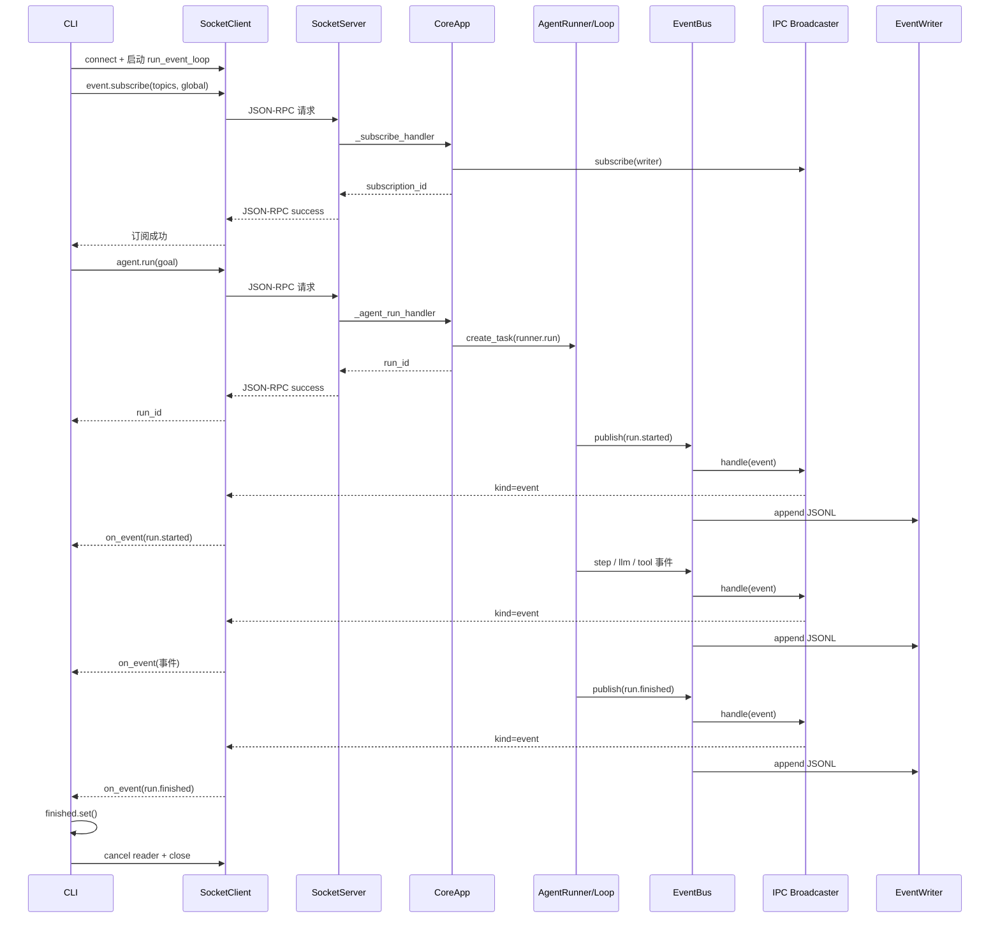

## 目录

1. [一页讲清楚 S2 学了什么](#1-一页讲清楚-s2-学了什么)
2. [与 S0、S1 的对照：真正变化的是什么](#2-与-s0s1-的对照真正变化的是什么)
3. [S2 架构总图与两条数据通路](#3-s2-架构总图与两条数据通路)
4. [优先阅读的源码文件清单](#4-优先阅读的源码文件清单)
5. [逐文件源码精读](#5-逐文件源码精读)
6. [一次 `kama run` 的端到端时序](#6-一次-kama-run-的端到端时序)
7. [IPC 协议实物：请求、响应、推送](#7-ipc-协议实物请求响应推送)
8. [异步知识点：Task、Future、ContextVar、背压](#8-异步知识点taskfuturecontextvar背压)
9. [异常、断线、回放与并发边界](#9-异常断线回放与并发边界)
10. [测试代码导读与本地验证](#10-测试代码导读与本地验证)
11. [从源码发现的工程隐患与改进练习](#11-从源码发现的工程隐患与改进练习)
12. [S2 应该掌握、但不必重复学习的 S1 内容](#12-s2-应该掌握但不必重复学习的-s1-内容)
13. [学习路线、实操任务、检验题](#13-学习路线实操任务检验题)
14. [面试复述模板与最终总结](#14-面试复述模板与最终总结)
15. [原始源码与证据目录](#15-原始源码与证据目录)

---

## 1. 一页讲清楚 S2 学了什么

### 1.1 记住这一句

> **S2 的核心不是让 Agent 更会思考，而是让 Agent 的执行权归 daemon 所有，并把执行过程以可订阅、可回放、可供多个前端消费的事件流外化出来。**

S0 解决**通信是否建立**；S1 解决**Agent 能否完成一次任务**；S2 解决**Agent 怎样在独立进程中长期运行，且让不同客户端观察同一运行过程**。

S2 可以拆为六个学习目标：

1. **执行权迁移**：S1 的 CLI 直接创建 `AgentRunner`；S2 的 CLI 只发送 `agent.run`，由 `CoreApp` 在 daemon 中创建并调度 `AgentRunner`。
2. **命令与事件分离**：`agent.run` 的响应只表示任务被启动/接受（返回 `run_id`），**不等于任务执行完成**。过程与结果通过 `run.*`、`step.*` 等事件接收。
3. **进程内发布订阅到进程间推送**：`EventBus` 保留进程内通知；新增加的 `IpcEventBroadcaster` 将事件变为 TCP 上的推送帧。
4. **同一连接承载两类帧**：JSON-RPC 响应走 `jsonrpc` 字段，推送事件走 `kind="event"` 字段；`SocketClient` 必须依不同类型分发。
5. **历史回放与现场观察**：`EventWriter` 把事件持续写到 `runs/<run_id>/events.jsonl`；`event.subscribe` 可选先回放旧日志，再订阅新事件。
6. **第二个前端出现**：`kama-tui` 在 S2 已有最小实时事件观察器，负责显示状态、token、工具调用和断线重连；它还**不是**后续完整交互式 Agent TUI。

### 1.2 最重要的三个心智模型

**模型 A：执行权与显示权分离**

```text
S1: CLI ──在自己的进程中──> AgentRunner → AgentLoop
S2: CLI ──RPC──> daemon ──创建后台任务──> AgentRunner → AgentLoop
                  │
                  └──事件流──> CLI / TUI / 日志文件
```

**模型 B：Command ≠ Event**

- Command 是“请做这件事”，例如 `agent.run`。
- Result 是“已接受请求，给你一个 `run_id`”，不是 Agent 的最终输出。
- Event 是“事情进行到哪里”，例如 `llm.token`、`tool.call_started`、`run.finished`。
- 由此产生**控制面**（RPC 命令）和**观察面**（事件推送）的区分。

**模型 C：一份事件，多种消费者**

```text
AgentLoop / LLM / Tool
      |
   EventBus
      ├── IpcEventBroadcaster ── TCP ──> 多个订阅客户端
      └── EventWriter ──> runs/<run_id>/events.jsonl
```

注意：这是**一条事件生产链上的多个消费者**，而不等于所有消费者都有独立、可靠、持久化的消息队列。

---

## 2. 与 S0、S1 的对照：真正变化的是什么

| 维度 | S0 | S1 | S2（核实分支 `stage/s2`） |
|---|---|---|---|
| 核心目标 | 进程拆分、Ping/Pong | 单次 Agent 工具闭环 | 事件流外化 + daemon 执行 Agent |
| CLI | 调用 daemon 的 ping | **本进程**创建 `AgentRunner` | 连接 daemon、订阅、请求 run、等待完成事件 |
| daemon | RPC 服务，处理 ping | 仍主要处理 ping | 注册 `core.ping`、`agent.run`、`event.subscribe` |
| AgentLoop | 未建立 | CLI 本地驱动 | 基本沿用 S1，改由 daemon 驱动 |
| EventBus | 基础协议类型 | 单次运行内消息分发 | **daemon 共享的事件总线** |
| 跨进程事件 | 无 | 无 | `IpcEventBroadcaster` 推送 |
| 事件文件 | 无 | `events.jsonl` | 保留，并提供历史回放 |
| 客户端协议 | 请求/响应 | Agent 执行不经过 IPC | 请求/响应与主动推送在同一连接复用 |
| TUI | 入口占位 | 尚非关键执行界面 | 最小实时事件面板，支持重连和可选回放 |
| 并发模型 | RPC 协程 | CLI 同步等待一次 run | daemon `create_task`，**同时只允许一个活跃 run** |

### 2.1 对照源码：S1 的关键形态

见 [S1 CLI run.py](https://raw.githubusercontent.com/youngyangyang04/KamaClaude/stage/s1/src/kama_claude/cli/commands/run.py) 末尾：CLI 创建 `StdoutPrinter`，把它的 `handle` 交给 `AgentRunner(..., extra_handlers=[...])`，再通过 `asyncio.run(runner.run(goal))` 执行。此时 CLI **既是控制方，又是执行方，还承担事件输出**。

见 [S1 CoreApp](https://raw.githubusercontent.com/youngyangyang04/KamaClaude/stage/s1/src/kama_claude/core/app.py)：daemon 只注册了 `core.ping`；Agent 并没有真正迁进 daemon。

### 2.2 对照源码：S2 的关键形态

见 [S2 CLI run.py](https://raw.githubusercontent.com/youngyangyang04/KamaClaude/stage/s2/src/kama_claude/cli/commands/run.py)：不再 import/实例化 `AgentRunner`，而是使用 `SocketClient`，先 `event.subscribe` 再 `agent.run`。

见 [S2 CoreApp](https://raw.githubusercontent.com/youngyangyang04/KamaClaude/stage/s2/src/kama_claude/core/app.py)：新增 `AgentRunner` 的实例化与 `asyncio.create_task(...)`，并注册 `event.subscribe`。

见 [S2 AgentRunner](https://raw.githubusercontent.com/youngyangyang04/KamaClaude/stage/s2/src/kama_claude/core/runner.py)：支持传入一个现有 `EventBus`，也支持从 daemon 外部传入 `run_id`；这两个接口变化是为了让 daemon **提前决定 run_id，并接到同一个广播总线**。

**重要结论：S2 对 AgentLoop 的智能机制没有做本质升级。它主要调整了所有权、生命周期、通信和可观测性。**

---

## 3. S2 架构总图与两条数据通路

### 3.1 组件图



> **图示约定**：这是一张职责图，不表示 `SocketServer` 在广播时重新接收一遍事件。实际 `IpcEventBroadcaster` 直接持有各连接的 `StreamWriter`，向对应 socket 写帧。

### 3.2 控制通路：client → server → 任务

```text
CLI/TUI 提交 RPC
    ↓
SocketServer._read_loop()
    ↓
SocketServer._handle_line()
    ↓
按 method 查找 CoreApp handler
    ↓
CoreApp._agent_run_handler()
    ↓
生成 run_id + 建立后台 Task
    ↓
RPC success，返回 run_id
```

### 3.3 观察通路：运行时 → 事件 → client

```text
AgentRunner、AgentLoop、Provider、工具执行器
    ↓  await bus.publish(Event)
EventBus.publish()
    ├── IpcEventBroadcaster.handle()
    │     ├── topic 和 scope 过滤
    │     └── StreamWriter.write() + drain()
    └── EventWriter.handle()
          └── events.jsonl 逐行写入并 flush
    ↓
SocketClient.run_event_loop()
    ↓
SocketClient._dispatch()
    ↓
CLI: StdoutPrinter / TUI: RichLog
```

### 3.4 为什么“先订阅再 run”很重要？

如果先提交 `agent.run`，daemon 立即创建后台 Task，Agent 可能先发布 `run.started`，而 CLI 还没有注册订阅，此时就可能**错过初始事件**。S2 CLI 采用“**先 `event.subscribe`，后 `agent.run`**”减少这一类丢失风险。注意这不代表 S2 已实现可靠投递协议。

---

## 4. 优先阅读的源码文件清单

建议严格依序阅读。路径均相对于 `src/kama_claude/`，并指向**已经核实存在**的源文件。

| 优先级 | 文件                                                                                                                                                             | 作用                | 阅读时盯住                         |
| --- | -------------------------------------------------------------------------------------------------------------------------------------------------------------- | ----------------- | ----------------------------- |
| P0  | [`core/app.py`](https://raw.githubusercontent.com/youngyangyang04/KamaClaude/stage/s2/src/kama_claude/core/app.py)                                             | daemon 控制总入口      | `CoreApp`、三个 handler、后台 task  |
| P0  | [`cli/commands/run.py`](https://raw.githubusercontent.com/youngyangyang04/KamaClaude/stage/s2/src/kama_claude/cli/commands/run.py)                             | 客户端 run 生命周期      | `_run_async`、`finished`       |
| P0  | [`core/transport/socket_client.py`](https://raw.githubusercontent.com/youngyangyang04/KamaClaude/stage/s2/src/kama_claude/core/transport/socket_client.py)     | 客户端协议分发           | `_pending`、`_dispatch`        |
| P0  | [`core/transport/ipc_broadcaster.py`](https://raw.githubusercontent.com/youngyangyang04/KamaClaude/stage/s2/src/kama_claude/core/transport/ipc_broadcaster.py) | IPC fan-out       | topic、scope、写失败清理             |
| P0  | [`core/transport/socket_server.py`](https://raw.githubusercontent.com/youngyangyang04/KamaClaude/stage/s2/src/kama_claude/core/transport/socket_server.py)     | 连接与 RPC 分发        | `ContextVar`、连接 finally       |
| P1  | [`core/runner.py`](https://raw.githubusercontent.com/youngyangyang04/KamaClaude/stage/s2/src/kama_claude/core/runner.py)                                       | 一次 run 的组装与事件生命周期 | 共享 bus、外部 run_id              |
| P1  | [`core/events/bus.py`](https://raw.githubusercontent.com/youngyangyang04/KamaClaude/stage/s2/src/kama_claude/core/events/bus.py)                               | 进程内事件通知           | 顺序 await                      |
| P1  | [`core/events/writer.py`](https://raw.githubusercontent.com/youngyangyang04/KamaClaude/stage/s2/src/kama_claude/core/events/writer.py)                         | 持久化事件             | JSONL、flush、订阅生命周期            |
| P1  | [`core/bus/commands.py`](https://raw.githubusercontent.com/youngyangyang04/KamaClaude/stage/s2/src/kama_claude/core/bus/commands.py)                           | 命令 schema         | `AgentRun*`、`EventSubscribe*` |
| P1  | [`core/bus/envelope.py`](https://raw.githubusercontent.com/youngyangyang04/KamaClaude/stage/s2/src/kama_claude/core/bus/envelope.py)                           | 消息 envelope       | `jsonrpc` 与 `kind`            |
| P1  | [`core/bus/events.py`](https://raw.githubusercontent.com/youngyangyang04/KamaClaude/stage/s2/src/kama_claude/core/bus/events.py)                               | 事件类型系统            | `run_id`、`type` 判别联合          |
| P1  | [`tui/app.py`](https://raw.githubusercontent.com/youngyangyang04/KamaClaude/stage/s2/src/kama_claude/tui/app.py)                                               | 最小 TUI 观察器        | worker、重连、token 缓冲            |
| P2  | [`core/runs.py`](https://raw.githubusercontent.com/youngyangyang04/KamaClaude/stage/s2/src/kama_claude/core/runs.py)                                           | run ID 和日志目录      | 相对路径与 ID 格式                   |
| P2  | [`core/loop.py`](https://raw.githubusercontent.com/youngyangyang04/KamaClaude/stage/s2/src/kama_claude/core/loop.py)                                           | 沿用的 Agent 循环      | 事件何时发出                        |
| P2  | [`core/context.py`](https://raw.githubusercontent.com/youngyangyang04/KamaClaude/stage/s2/src/kama_claude/core/context.py)                                     | 执行上下文             | status 和 reason               |
| P2  | [`core/llm/provider.py`](https://raw.githubusercontent.com/youngyangyang04/KamaClaude/stage/s2/src/kama_claude/core/llm/provider.py)                           | 模型流式事件生产          | `llm.token`、`llm.usage`       |
| P2  | [`core/tools/invocation.py`](https://raw.githubusercontent.com/youngyangyang04/KamaClaude/stage/s2/src/kama_claude/core/tools/invocation.py)                   | 工具执行事件生产          | started/finished/failed       |
| P2  | [`tui/__main__.py`](https://raw.githubusercontent.com/youngyangyang04/KamaClaude/stage/s2/src/kama_claude/tui/__main__.py)                                     | TUI 入口            | `--replay` 参数                 |
| P2  | [`WIRE_PROTOCOL.md`](https://raw.githubusercontent.com/youngyangyang04/KamaClaude/stage/s2/WIRE_PROTOCOL.md)                                                   | 代码生成的协议文档         | 请求和推送报文示例                     |

---

## 5. 逐文件源码精读

### 5.1 `core/app.py`：S2 的执行权真正迁移到这里

**定位**：[源文件第 29–108 行](https://raw.githubusercontent.com/youngyangyang04/KamaClaude/stage/s2/src/kama_claude/core/app.py)。

#### 一、构造函数建立 daemon 的长期对象

- `self._bus = EventBus()`：这是 daemon 持有的共享事件总线，不再每次在 CLI 内独立建立。
- `self._broadcaster = IpcEventBroadcaster()`：持有 IPC 订阅列表。
- `self._bus.subscribe(self._broadcaster.handle)`：直接把广播器挂到总线上，之后任何使用该 bus 的 Agent 事件都可经广播器推送。
- `self._current_run_task`：跟踪当前运行中的异步任务。
- `self._config`：启动 daemon 时载入，后续创建 Runner 使用。

**要理解的所有权关系**：

```text
CoreApp 生命周期较长
   ├── EventBus（长生命周期）
   ├── IpcEventBroadcaster（长生命周期）
   └── current Task（单次 run 生命周期）
        └── AgentRunner → AgentLoop、Provider、ToolRegistry
```

#### 二、`_agent_run_handler()`：不是跑完返回，而是启动后立刻返回

源码逻辑：

1. 从 RPC 的 `params` 验证得到 `AgentRunCommand`，读取 `goal`。
2. 检查是否已有**未完成**的 `_current_run_task`；有就抛出 `RuntimeError`。
3. 生成 `run_id`。
4. 创建 `AgentRunner(config, bus=self._bus)`，让运行实例接入 daemon 的共享事件总线。
5. `asyncio.create_task(runner.run(goal, run_id=run_id))`，把执行调度到当前事件循环。
6. **立即**返回包含 `run_id` 的 `AgentRunResult`。

教学伪代码（不等于原文件的逐行复刻）：

```python
async def accept_run(goal):
    if running_task_exists():
        raise RuntimeError("busy")
    rid = allocate_run_id()
    running_task = schedule(agent_runner(shared_bus).run(goal, rid))
    return {"run_id": rid}        # 此时任务一般尚未结束
```

**重点**：`create_task` 创建并调度一个协程，handler 无须等待 LLM/工具跑完就能结束 RPC 请求。**这是 S2 区别于 S1 的第一关键点。**

**并发范围提醒**：S2 通过一个 `_current_run_task` 防止重叠执行，故它**不具备多 run 真正并行能力**；不要把后续 main/S4/S5 的能力倒灌进来。

#### 三、`_subscribe_handler()`：允许客户端注册主题订阅

流程：

1. 用 `EventSubscribeCommand` 验证 `topics`、`scope`、`replay_from_run`。
2. 调用 `get_connection_writer()` 取得“当前处理这条 RPC 所在的 TCP 连接”。
3. 若有 `replay_from_run`：打开对应 `events.jsonl`，读取历史并发送。
4. 向 `IpcEventBroadcaster` 注册该 `writer` 的实时订阅。
5. 返回 `subscription_id` 和 `replayed_count`。

这里有两个**顺序上的事实**：

- 源码明确是**先历史回放，再注册实时订阅**；
- 历史回放通过写入 `EventPushEnvelope` 实现，虽然调用的还是 `event.subscribe` 这条 RPC，但客户端在响应之前可能先收到若干 `kind=event` 帧。

这解释了为什么 `SocketClient` 不能简单地“发送一条命令，再直接 `readline()` 读取下一行作为命令响应”。下一行也可能是事件。

#### 四、`_replay_events()`：历史数据重新变为 IPC 事件

- 路径由 `events_file(run_id)` 构建。
- 文件不存在则回放 0 条。
- 逐行读取，空行跳过，坏 JSON 跳过。
- `fnmatch.fnmatch(event_type, topic_pattern)` 匹配允许回放的类型。
- 每条匹配事件包在 `EventPushEnvelope` 后写入原订阅连接。
- 批量写完后 `drain()`；返回数量。

**注意**：这属于“**事件日志重放给 UI**”，不是“把 LLM/工具重新执行一遍”。

#### 五、`CoreApp.run()` 注册三个 RPC 方法

- `core.ping`：沿用 S0。
- `agent.run`：S2 加入真实 agent 执行。
- `event.subscribe`：S2 加入观察入口。

S2 全链路由此形成。`kama-core` 才是持有执行能力的主进程。

---

### 5.2 `core/runner.py`：连接共享总线、执行循环、保存证据

**定位**：[源文件第 20–77 行](https://raw.githubusercontent.com/youngyangyang04/KamaClaude/stage/s2/src/kama_claude/core/runner.py)。

#### 相比 S1 的两项接口升级

- `__init__` 新增 `bus: EventBus | None`：如果 daemon 提供已有总线则复用；否则自己新建。
- `run` 新增可选 `run_id`：允许 daemon 在 RPC 返回之前先建立 ID，以便客户端后续跟踪。

这两个改动比它们看起来更重要：**只要使用共享 EventBus，AgentRunner 内部生产的事件就自动接入所有早已在 daemon 注册的订阅者。** 因此无需把 Socket/TUI 的细节塞进 AgentLoop。

#### 运行生命周期

1. 确定 `run_id`，创建 `runs/<run_id>/`。
2. 选定 EventBus，并挂入传入的额外 handler。
3. 初始化 `ExecutionContext`（goal、最大步数、run_id）。
4. 进入 `EventWriter` 的异步上下文，打开 `events.jsonl`。
5. 把 `EventWriter.handle` 加到 EventBus。
6. 发布 `RunStartedEvent`。
7. 组装 `LLMProvider`、`ToolRegistry`、`ReadFileTool`、`AgentLoop`。
8. `await AgentLoop.run(context)`：LLM、工具和执行上下文按 S1 的规则运行。
9. 捕获取消信号，把 context 标记为失败（reason `cancelled`）。
10. 发布 `RunFinishedEvent`（status、reason、steps），离开文件上下文关闭文件。
11. 如果确实遭到取消，再重新抛出 `CancelledError`。

#### 需要主动思考的问题

为什么 `RunFinishedEvent` 在 `except CancelledError` 之后统一发布？因为“被取消”也是一次**有结果的运行终态**，需要告诉观察者结束了。

为何让 `AgentRunner` 接受 `provider` 和 `runs_dir` 注入？S1 就有的接口，可在测试中用假 LLM 或临时目录，不需要打真实外部 API。

**边界**：目前只专门捕获 `CancelledError`。例如在组装 Provider 阶段直接异常退出，源码不保证仍会发布 `run.finished`。这是 S2 可靠性补强的题目，详见第 11 节。

---

### 5.3 `core/events/bus.py`：极简 EventBus，是所有解耦的枢纽

**定位**：[全部 20 行](https://raw.githubusercontent.com/youngyangyang04/KamaClaude/stage/s2/src/kama_claude/core/events/bus.py)。

只做两件事：

- `subscribe(handler)`：向列表追加一个异步事件处理函数。
- `publish(event)`：依照注册顺序，**依次 `await`** 每一个 handler。

几个反直觉的结论：

1. 这不是独立消息队列，也不创建并行消费者 task；所有订阅者是在本次 `publish` 内顺序处理。
2. 若某个订阅者很慢，发布协程需要等它完成，可能拖慢 Agent 的 token 流。
3. 若订阅者直接抛出未捕获的异常，`publish` 可能中断，后面的订阅者可能无法得到事件。
4. EventBus 不负责保存历史，也不自动清理订阅者；持久化与连接清理由别的组件负责。

**S2 的设计价值**不在于 EventBus 代码复杂，而在于“所有子系统只依赖 EventBus 的 publish/subscribe 接口，具体输出通道可增减”。

---

### 5.4 `core/events/writer.py`：JSONL 是轻量事件证据，不是完整消息代理

**定位**：[全部 41 行](https://raw.githubusercontent.com/youngyangyang04/KamaClaude/stage/s2/src/kama_claude/core/events/writer.py)。

- `__aenter__`：按**追加模式**打开 UTF-8 文件。
- `subscribe(bus)`：注册 `handle` 到 EventBus。
- `handle(event)`：一条事件序列化为一行 JSON，写入并 `flush()`。
- `__aexit__`：关闭文件，将 `_file` 重置为 None。
- 写文件中的 `OSError` / `ValueError` 被记录到日志，避免它们直接让 Agent 主链路失败。

JSON Lines 的好处：**无须等整次 run 完成才能查看进度**；崩溃后仍可读到此前 flush 的行；按行易解析和回放。

和成熟事件日志系统的区别：它没有每事件递增 sequence、事务、ACK、跨客户端游标，**不要误认为这是 exactly-once 可靠消息系统**。

---

### 5.5 `core/transport/ipc_broadcaster.py`：进程内事件跨越进程边界

**定位**：[源文件第 15–74 行](https://raw.githubusercontent.com/youngyangyang04/KamaClaude/stage/s2/src/kama_claude/core/transport/ipc_broadcaster.py)。

#### 订阅数据结构

每个 `_Subscription` 保存：

- `sub_id`：客户端订阅标识。
- `writer`：TCP 连接写端，**实际推送的目标**。
- `topics`：类型通配过滤器，例如 `run.*`、`step.*`。
- `scope`：`global` 或 `run:<id>`。

#### `subscribe` / `unsubscribe`

- `subscribe(writer, topics, scope)` 为连接添加一条订阅，返回类似 `sub-...` 的 ID。
- `unsubscribe(writer)` 删除和这个 writer 关联的**全部**订阅，防止连接断开后残留。

#### `handle(event)` 的完整思路

1. Pydantic 事件变成 dict，读取 `type`、`run_id`。
2. 遍历订阅快照 `list(self._subscriptions)`。
3. 检查类型是否匹配 `topics`。
4. 检查 `scope` 是否允许这个 `run_id`。
5. 构造 `EventPushEnvelope`，写为 NDJSON 帧并等待 `drain()`。
6. 捕获连接重置、断管或 OSError，暂存死连接。
7. 一轮遍历后统一清理死连接。

#### 两层过滤很重要

- **topic**：我想看到哪些种类的事件。
- **scope**：我想看到哪些 run 的事件。

例如主题 `tool.*` 且 scope `run:abc`，只应接收 ID 为 `abc` 的工具事件。

`global` 的含义是全部运行的匹配事件。若两个前端同时订阅 `global`，它们都可观察同一 run，而**不是其中一个“抢走”事件**。

#### 异常行为

写入失败清理的是**该 TCP writer 的订阅**，不是删除 run、停止 Agent。也就是说：**断开观察者不等于停止执行者**。

---

### 5.6 `core/transport/socket_server.py`：RPC 生命周期与 TCP 连接上下文

**定位**：[源文件第 23–143 行](https://raw.githubusercontent.com/youngyangyang04/KamaClaude/stage/s2/src/kama_claude/core/transport/socket_server.py)。

#### 来自 S0 的部分

- 监听本地 TCP 地址，默认 `127.0.0.1:7437`。
- 一行 NDJSON 对应一个请求。
- 验证 JSON-RPC 结构，并按 `method` 路由到已注册 handler。
- 将 Pydantic 模型返回值转成 `JsonRpcSuccess`，为异常情况生成 JSON-RPC 错误帧。
- 单帧限制按 1MB 配置（另有读取异常路径）。

#### S2 的主要变化

1. `SocketServer` 可持有一个 `IpcEventBroadcaster`。
2. 为每条连接维护独立的接收 loop。
3. **连接关闭时**，在 `finally` 中调用 `broadcaster.unsubscribe(writer)`，确保订阅资源被回收。
4. 使用 `ContextVar[StreamWriter]` 记住当前正在执行的 RPC 所属连接。

#### 为什么需要 `ContextVar`？

`_subscribe_handler(params)` 只接收命令参数，不显式接收 `writer`。但订阅必须绑定“是谁发来的请求”，因此 `SocketServer` 调用 handler 之前写入连接上下文，`CoreApp` 内部再通过 `get_connection_writer()` 获取正确 writer。

这是 Python asyncio 中很实用的模式：**每个任务上下文有自己的上下文变量值**，既避免把连接参数层层传递，也避免错误地用进程级全局变量指向最后一个客户端。

理解成“并发请求自己的隐式上下文”，但仍应注意在复用长生命周期协程或跨 Task 传播时保持明确的生命周期界限。

#### Server 视角的一条请求

```text
readline → json.loads → JsonRpcRequest 校验
         → handlers[req.method]
         → 设置当前连接 writer 的 ContextVar
         → await handler(params)
         → JsonRpcSuccess / JsonRpcError 写回
```

当连接进入 `event.subscribe` 后，连接不会变成“只发不收”的特殊协议：它**仍可继续收发 JSON-RPC，且被广播器用于服务端事件推送**。

---

### 5.7 `core/bus/envelope.py`：S2 的混合帧协议

**定位**：[全部 44 行](https://raw.githubusercontent.com/youngyangyang04/KamaClaude/stage/s2/src/kama_claude/core/bus/envelope.py)。

记住三类对象：

- `JsonRpcRequest`：`jsonrpc`、`id`、`method`、`params`。
- `JsonRpcSuccess` / `JsonRpcError`：`jsonrpc`、`id`、`result` 或 `error`。
- **`EventPushEnvelope`**：`kind="event"`、`event={...}`。

**S2 协议学习重点**：`EventPushEnvelope` 是主动消息，**没有匹配一个客户端 RPC request id 的必要**；而普通 RPC 响应必须靠 `id` 找到对应请求。

从“请求响应模型”升级成“请求响应 + 主动消息推送模型”，后续很多实时交互能力依赖这个基础。

---

### 5.8 `core/bus/commands.py`：两个新增请求契约

**定位**：[源文件第 18–40 行](https://raw.githubusercontent.com/youngyangyang04/KamaClaude/stage/s2/src/kama_claude/core/bus/commands.py)。

#### `AgentRunCommand` / `AgentRunResult`

- 请求含 `goal`。
- 响应含 `run_id`。
- 该结果只确认创建/接受 run，**不直接携带最终 answer**。

#### `EventSubscribeCommand` / `EventSubscribeResult`

- 请求含 `topics: list[str]`。
- `scope` 默认 `global`。
- `replay_from_run` 可空，用于指定历史 run。
- 响应包含 `subscription_id`、`replayed_count`。

这里的 `Command = Annotated[..., Discriminator("type")]` 表达**按 `type` 判别命令子类型**的类型化协议设计。真实 SocketServer 还会按 JSON-RPC 外层 `method` 分发；**外层 `method` 和内层命令 `type` 不要混淆**。

---

### 5.9 `core/bus/events.py`：规范每类事件的形状

**定位**：[源文件第 7–114 行](https://raw.githubusercontent.com/youngyangyang04/KamaClaude/stage/s2/src/kama_claude/core/bus/events.py)。

| 事件名 | 主要字段 | 语义 |
|---|---|---|
| `run.started` | `run_id`, `goal`, `ts` | 接受后开始执行 |
| `run.finished` | `run_id`, `status`, `reason`, `steps`, `ts` | run 终态 |
| `step.started` / `step.finished` | `run_id`, `step`, `ts` | 每一轮 Agent 循环边界 |
| `tool.call_started` | `tool_use_id`, `tool_name`, `params` | 某个工具开始执行 |
| `tool.call_finished` | `tool_use_id`, `elapsed_ms` | 工具成功完成 |
| `tool.call_failed` | `error_type`, `error_message`, `elapsed_ms` | 工具调用失败 |
| `llm.token` | `token` | 模型流式文本片段 |
| `llm.usage` | token 统计 | API 用量信息 |
| `llm.model_selected` | `model`, `strategy` | 选择了哪个模型 |
| `log.line` | `level`, `source`, `message` | 普通日志事件 |
| `core.started` | `listen_addr`, `version` | core 生命周期事件类型 |

注意：这个表是对已定义的事件类型的解释，**不代表每种事件在每一次 S2 run 中都会出现**。

这份类型文件还体现了两个规范：

- 大多数 run 范围事件都有 `run_id`，供订阅器做 scope 过滤；
- `type` 字段兼具前端 UI 渲染分支和 Pydantic discriminated union 标记的作用。

---

### 5.10 `core/transport/socket_client.py`：S2 最值得反复读的客户端文件

**定位**：[源文件第 20–95 行](https://raw.githubusercontent.com/youngyangyang04/KamaClaude/stage/s2/src/kama_claude/core/transport/socket_client.py)。

#### 数据结构

- `_reader` / `_writer`：一条 TCP 连接的读写对象。
- `_pending: dict[str, Future]`：保存“RPC 请求 ID → 尚未完成的 Future”。
- `_event_handlers`：客户端收到事件后的回调列表。

#### `send_command()` 到底做了什么？

1. 生成随机请求 ID。
2. 创建 `JsonRpcRequest`。
3. 为当前请求创建一个 `Future`，存入 `_pending[request_id]`。
4. 向 socket 写入请求并 `drain()`。
5. `await Future`，等待**后台读取循环**把对应响应投递过来。

**Future 的含义**：它不是“一个已经在后台执行的 Agent 任务”，而是客户端等待**某条 RPC 响应**完成的一次性承诺对象。

#### `run_event_loop()` 到底做了什么？

不停 `readline()`，读到每条完整 NDJSON 帧就调用 `_dispatch()`，连接关闭时清理尚未完成的 pending Future。

#### `_dispatch()` 如何判断一行消息属于谁？

```text
收到一条 JSON dict
    ├── 包含 jsonrpc
    │      └── 通过 id 找到 pending Future
    │               ├── result → set_result
    │               └── error  → set_exception(IpcError)
    └── kind == event
           └── 依次交给每个 on_event 注册的 handler
```

**核心问题**：为什么 `send_command()` 与 `run_event_loop()` 必须同时存在？

因为 `send_command` 自己不读 socket，而是在等一个 Future。如果没有另一个协程运行 `run_event_loop` 并处理服务端响应，**Future 永远没人 set_result**，命令可能一直挂起。

**扩展认识**：请求的完成顺序和事件到达顺序不必一一对应，ID 关联机制使客户端可以区分不同 RPC 的响应。

---

### 5.11 `cli/commands/run.py`：S2 CLI 已经退化为一个 IPC 客户端

**定位**：[源文件第 58–110 行](https://raw.githubusercontent.com/youngyangyang04/KamaClaude/stage/s2/src/kama_claude/cli/commands/run.py)。

精读 `_run_async()` 的顺序：

1. 建立到 daemon 的连接，连接失败时打印 `core not running` 并退出。
2. 构建 `StdoutPrinter`，设置一个 `asyncio.Event` 作为终止信号。
3. 注册 `on_event()`：所有事件交给打印器；遇到 `run.finished` 则设置完成信号，并按成功/失败计算 CLI 返回码。
4. 创建 `client.run_event_loop()` 后台协程，为 RPC Future 和推送帧提供**持续读取者**。
5. 向 daemon 发送 `event.subscribe`，先订阅运行/步骤/工具/token/usage 等事件。
6. 发送 `agent.run`。
7. **等待 `finished.wait()`**，而不是等待 `agent.run` 的 RPC 结果来代表任务结束。
8. 收到结束事件后取消读取协程、关闭连接、返回退出码。

你应当能回答：**这里有几个需要等待的东西？**

- 第一次 `await send_command("event.subscribe")`：等待订阅 RPC 结果；
- 第二次 `await send_command("agent.run")`：等待任务已启动的 RPC 结果；
- `await finished.wait()`：等待真正的业务终态 `run.finished`；
- 清理时等待 reader task 取消结束。

这与 S1 同步 `asyncio.run(runner.run(goal))` 的差异，是 S2 最值得背下来的调用链。

---

### 5.12 `tui/app.py`：最小 TUI 不是第二个 Agent 实现

**定位**：[源文件第 13–134 行](https://raw.githubusercontent.com/youngyangyang04/KamaClaude/stage/s2/src/kama_claude/tui/app.py)。

- 框架：Textual。
- 界面：一行连接状态 `Label` + 事件滚动面板 `RichLog`。
- `on_mount`：通过 `run_worker` 启动长生命周期 socket 协程。
- `_socket_loop`：连接 daemon → 注册事件回调 → 发送 `event.subscribe` → 持续等待网络事件 → 连接断开后尝试重连（2 秒）。
- 订阅 topics 包括 `run.*`、`step.*`、`tool.*`、`llm.token`、`llm.usage`、`log.*`，scope 为 `global`。
- `_handle_event`：根据 `type` 不同渲染不同的日志行。
- `llm.token`：先积累到 `_token_buf`，遇到其他事件或断线后再刷新到 RichLog，避免每个 token 都产生一行。

重要限制：

1. S2 TUI 的定位是**最小观察器**，并没有源码级实现交互式 goal 输入、任务规划编辑、审批卡片等后来功能。
2. `kama-tui --replay RUN_ID` 通过 `tui/__main__.py` 传入可选历史 ID。
3. `_socket_loop` 在断线后会重新建立连接/订阅；但是没有声明“自动从上次准确消费到的事件序号续播”。

---

### 5.13 `core/runs.py`：run_id 是整个可观察系统的关联键

**定位**：[全部 29 行](https://raw.githubusercontent.com/youngyangyang04/KamaClaude/stage/s2/src/kama_claude/core/runs.py)。

- 默认文件目录 `RUNS_DIR = Path("runs")`，是**进程工作目录下的相对路径**。
- run ID 由 UTC 时间戳与随机后缀组成，便于识别与降低冲突概率。
- `run_dir(run_id)`、`events_file(run_id)` 组合目标文件路径。

核心关系：

```text
run_id（一个业务运行实例）
    ├── RPC agent.run 的 result.run_id
    ├── Event 的 run_id 字段
    ├── 订阅范围 run:<run_id>
    └── runs/<run_id>/events.jsonl
```

**这不是 Session**：S2 的 `run_id` 代表一次任务运行，不等同于 S4 后引入的会话 ID；不能把“重播某次 run”说成“继续多轮聊天上下文”。

---

### 5.14 `core/loop.py`、`context.py`、`llm/provider.py`、`tools/invocation.py`：理解但不必重新从零啃

这些文件承接 S1 的核心 Agent 机制，在 S2 讲解中应该认识它们如何**生产事件**：

- `AgentLoop.run()` 在 step 开始/结束时发布 `step.*`，把模型消息和工具结果写回 `ExecutionContext`，直到模型完成或达到步数上限。
- `AnthropicProvider.chat()` 调用模型流式 API，并发布 `llm.model_selected`、`llm.token`、`llm.usage`。
- `invoke_tool()` 在工具调用前发布 `tool.call_started`；成功后发 `tool.call_finished`；失败时发 `tool.call_failed` 并把错误表达成 `ToolResult`。
- `ExecutionContext` 保存 messages、step、status、reason，供 Runner 构造 `run.finished` 事件。

**S2 的思路是复用这些已有生产点，把新能力放在事件消费侧与进程边界上。** 这体现了改造范围受控、少侵入 AgentLoop 的工程设计。

---

## 6. 一次 `kama run` 的端到端时序

### 6.1 时序图



> **时序细节**：`create_task` 会把 Agent 协程排进事件循环，真正开始运行的具体时刻与 RPC 响应发送的相对先后可能受调度影响；上图表示逻辑职责，不承诺所有连接上严格是某个固定交错顺序。

### 6.2 阅读时应区分四种“完成”

| 表述 | 实际含义 | 是否表示任务完成 |
|---|---|---|
| `event.subscribe` RPC 返回 | 客户端已注册实时订阅（可能先回放历史） | 否 |
| `agent.run` RPC 返回 | daemon 已接受/调度一次 run | 否 |
| `step.finished` | Agent 的某一轮已结束 | 不一定 |
| `run.finished` | 整次 run 进入终态 | 是 |

### 6.3 当用户关闭 CLI 会怎么样？

CLI 的连接被关闭，server 连接处理流程清理该 writer 的订阅。**根据 S2 的这条所有权关系，单纯断开 CLI 不会直接调用 `AgentRunner` 的取消方法。** daemon 内的 Agent Task 与客户端连接生命周期是分离的。若 daemon 本身停止，则还需考虑事件循环退出对 Task 的影响，不能误解为 Agent 一定会继续运行到结束。

---

## 7. IPC 协议实物：请求、响应、推送

下面 JSON 为依据类型定义手写的**教学示例**，字段值是演示性的，不是声称实际执行生成的抓包。

### 7.1 注册订阅

客户端 → daemon：

```json
{"jsonrpc":"2.0","id":"req-1","method":"event.subscribe","params":{"topics":["run.*","step.*","tool.*","llm.token"],"scope":"global"}}
```

daemon → 客户端：

```json
{"jsonrpc":"2.0","id":"req-1","result":{"subscription_id":"sub-demo","replayed_count":0}}
```

### 7.2 启动任务

客户端 → daemon：

```json
{"jsonrpc":"2.0","id":"req-2","method":"agent.run","params":{"goal":"阅读项目 README 并给出摘要"}}
```

daemon → 客户端：

```json
{"jsonrpc":"2.0","id":"req-2","result":{"run_id":"20261022-000000-abcdef"}}
```

### 7.3 服务端主动推送

假设客户端已经订阅：

```json
{"kind":"event","event":{"type":"run.started","run_id":"20261022-000000-abcdef","goal":"阅读项目 README 并给出摘要","ts":"2026-10-22T00:00:00+00:00"}}
```

```json
{"kind":"event","event":{"type":"step.started","run_id":"20261022-000000-abcdef","step":1,"ts":"2026-10-22T00:00:01+00:00"}}
```

```json
{"kind":"event","event":{"type":"run.finished","run_id":"20261022-000000-abcdef","status":"success","reason":null,"steps":1,"ts":"2026-10-22T00:00:02+00:00"}}
```

### 7.4 这里的“事件”不是 JSON-RPC Notification

项目定义了**自己的 EventPushEnvelope**（`kind=event`），而非直接使用 JSON-RPC Notification 的标准 `method` 消息形状。这是**项目层的协议约定**。若你自己实现兼容客户端，必须按仓库契约识别这种消息，而不能只凭通用 JSON-RPC 客户端默认支持就认为能处理推送。

---

## 8. 异步知识点：Task、Future、ContextVar、背压

### 8.1 `asyncio.create_task`：运行中的业务协程

位置：`CoreApp._agent_run_handler`。

作用：把 `AgentRunner.run` 变成可独立推进的 Task。`agent.run` 的 handler 先返回，任务在事件循环中继续推进。**Task 代表 daemon 的实际执行活动。**

### 8.2 `asyncio.Future`：等待某条 RPC 的结果

位置：`SocketClient._pending` 与 `send_command`。

作用：把一条“未来某时到达的 RPC 响应”与已发送请求绑定。`_dispatch` 收到 `id` 匹配的响应后调用 `set_result` 或 `set_exception`。

**两者不要混为一谈**：daemon 的 Task 可能仍在执行，客户端对应 `agent.run` RPC 的 Future 却已经完成。

### 8.3 `asyncio.Event`：只关心完成与否的通知

位置：CLI `_run_async` 的 `finished`。

`run.finished` 到达后 `finished.set()`，等待它的协程就会继续执行。这里不通过 Event 传递复杂 payload，因为 `exit_code` 在事件 handler 内维护。

### 8.4 `ContextVar`：按异步任务传播的连接上下文

位置：`SocketServer`。解决 `_subscribe_handler` 需要知道当前客户端的 writer，而 handler 形参没有 writer 的问题。

### 8.5 `StreamWriter.drain`：等待发送缓冲状况

位置：SocketClient、SocketServer、IpcEventBroadcaster。

`write()` 是向发送缓冲区放内容，不代表对端已经处理了它；`drain()` 是 asyncio 进行流量控制的协作点，**不是接收方业务 ACK**。

### 8.6 背压（Backpressure）

源码中的 `EventBus.publish` 顺序 `await` handler，而 `IpcEventBroadcaster.handle` 又顺序 `await writer.drain()`。于是，**最慢的订阅连接可能拖慢整个 `publish`，甚至拖慢依赖事件发布的模型 token 处理路径**。

可选工程改进：每个订阅者建立有界 `asyncio.Queue`，独立 writer task 发送，定义丢包/合并/断连策略，并监控队列深度。但这是升级建议，**不是 S2 现有机制**。

---

## 9. 异常、断线、回放与并发边界

### 9.1 客户端无法连接 daemon

S2 CLI 捕获 `ConnectionRefusedError` 或 `OSError`，提示 `core not running`，返回非零退出码。TUI 选择延时重连，而不立即退出。

### 9.2 同时两个客户端发 `agent.run`

`CoreApp._agent_run_handler` 检查 `_current_run_task`；当已有任务未完成时抛 `RuntimeError`，由 `SocketServer` 外层变成服务器错误响应。**单个 daemon 的 S2 是单活跃 run，而不是多 Agent 调度服务。**

### 9.3 工具失败与模型失败不同

S1 沿用的 `invoke_tool` 会把许多工具错误包装为 `ToolResult`，发布 `tool.call_failed`，再回填给模型让它后续处理；模型层异常可能让上下文直接 `mark_failed("llm_error")`。

### 9.4 客户端连接断开

`SocketServer._handle_connection` 的 finally 清理订阅。广播器遇到 `BrokenPipeError` / `ConnectionResetError` / `OSError` 也会删除死连接。run 不因此直接被取消。

### 9.5 发生回放时到底会收到什么？

使用 `kama-tui --replay RUN_ID` 时，`event.subscribe` 携带 `replay_from_run`。CoreApp 把指定 run 的 JSONL 事件逐条以 `kind=event` 发送，再注册实时监听。

**不可推断的功能**：不表示支持任意时间点游标、重放 LLM 请求、恢复尚未完成的工具动作或保证原始事件时序与 live 无缝衔接。

### 9.6 TUI 自身崩溃/退出

只要 daemon 仍存活且业务 task 未终止，TUI 可以重开，订阅 live；指定历史 run ID 还能请求日志回放。这是 S2 把执行权独立出去的真实工程收益。

---

## 10. 测试代码导读与本地验证

### 10.1 源码核实过的测试文件

| 测试 | 核心覆盖点 | 为什么值得读 |
|---|---|---|
| [`tests/unit/test_event_bus.py`](https://raw.githubusercontent.com/youngyangyang04/KamaClaude/stage/s2/tests/unit/test_event_bus.py) | 单/多订阅者、顺序、空订阅 | 验证 EventBus 是按注册顺序依次调用 |
| [`tests/unit/test_ipc_broadcaster.py`](https://raw.githubusercontent.com/youngyangyang04/KamaClaude/stage/s2/tests/unit/test_ipc_broadcaster.py) | topic、scope、unsubscribe、坏连接 | 验证事件过滤和 fan-out |
| [`tests/unit/test_socket_client.py`](https://raw.githubusercontent.com/youngyangyang04/KamaClaude/stage/s2/tests/unit/test_socket_client.py) | RPC result、RPC error、事件 push、关闭连接 | 验证一个连接复用双通路 |
| [`tests/conftest.py`](https://raw.githubusercontent.com/youngyangyang04/KamaClaude/stage/s2/tests/conftest.py) | `free_port`、`running_daemon` | 如何用真实子进程测 IPC |

#### EventBus 测试应该读懂什么？

测试中用记录列表保存 handler 的调用结果，用 `order` 确定订阅者的执行次序。在 S2 中顺序很重要，因为它影响事件先被哪些消费者处理。

#### Broadcaster 测试应该读懂什么？

构造假 `StreamWriter`，直接观察写出的 NDJSON bytes，无须打开真实 TCP；验证 topic 过滤、run scope 过滤与坏连接清理。

#### SocketClient 测试应该读懂什么？

用 `asyncio.start_server(..., port=0)` 建立本地 mock server；client 的 `run_event_loop()` 与 `send_command()` 必须并发运行；以 `asyncio.wait_for` 防止挂起；验证先 RPC 响应再推送事件也能正确分发。

#### `conftest.py` 应该读懂什么？

通过随机空闲端口启动独立 daemon 子进程，再轮询连通并在 teardown 发送终止信号。测试命令/协议不要只用单元 mock，至少要有一层真实网络整合测试。

### 10.2 本地执行环境

官方 `stage/s2` README 列出 Python 3.12、macOS/Linux、uv。建议先使用**验证过的 `stage/s2`**：

```bash
git clone https://github.com/youngyangyang04/KamaClaude.git
cd KamaClaude
git fetch --all --prune
git switch --detach origin/stage/s2
uv sync
cp .env.example .env
```

为 `ANTHROPIC_API_KEY` 和所用模型配置真实可用的值；若想避免调用真实 API，可先只做 ping/IPC 的 mock 单测。

### 10.3 一次最小运行实验

终端 A：

```bash
uv run kama-core
```

终端 B：

```bash
uv run kama ping
uv run kama run --goal "总结项目 README.md 的主要结构"
```

终端 C（运行中打开）：

```bash
uv run kama-tui
```

注意：`kama-tui` 在这里主要用于**观察**，由 CLI 发起 run。

### 10.4 查找 run ID、验证事件文件

```bash
find runs -name events.jsonl -print
```

用 Python 查看文件事件类型与出现次数（本例是自行编写的辅助脚本）：

```python
from collections import Counter
import json
from pathlib import Path

files = sorted(Path("runs").glob("*/events.jsonl"))
if not files:
    raise SystemExit("未找到事件文件，请先完成一次 run")
path = files[-1]
items = [json.loads(line) for line in path.read_text(encoding="utf-8").splitlines() if line.strip()]
print("文件:", path)
print("总事件:", len(items))
print("类型统计:", Counter(item.get("type") for item in items))
print("首事件:", items[0].get("type"))
print("尾事件:", items[-1].get("type"))
```

### 10.5 回放实验

先从 `runs/` 找到一个完成的 run ID，之后：

```bash
uv run kama-tui --replay <RUN_ID>
```

观察：没有重新发送 `agent.run`，TUI 仍能显示旧 run 的事件；它从日志获得的是**过去的输出历史**而非重新执行结果。

### 10.6 测试命令

```bash
uv run pytest tests/unit/test_event_bus.py -v
uv run pytest tests/unit/test_ipc_broadcaster.py -v
uv run pytest tests/unit/test_socket_client.py -v
uv run pytest tests/ -v
uv run ruff check src tests scripts
uv run mypy src
uv run python scripts/gen_protocol_doc.py --check
```

**诚实说明**：这些是依据源码和项目文档给出的**本地可执行步骤**；本次阅读环境不能克隆仓库，也没有在用户机器上执行 pytest/真实模型请求，故不声称测试全部通过。

---

## 11. 从源码发现的工程隐患与改进练习

> 本节是**代码审阅推论与可验证假设**，不是官方教程既定结论或已复现的问题报告。每项都能从上述源码追踪到对应设计，并可通过补测试确认。

### P0：CLI 未严格校验 `run.finished` 属于自己的 `run_id`

位置：[`cli/commands/run.py` 的 `on_event`](https://raw.githubusercontent.com/youngyangyang04/KamaClaude/stage/s2/src/kama_claude/cli/commands/run.py)。

客户端订阅的是 `scope="global"`，回调只判断 `event.type == "run.finished"`，没有比较 `event.run_id == agent.run 返回的 run_id`。所以它把所有全局 `run.finished` 都作为当前命令终态的**风险**确实存在。由于 S2 单活跃 run 的限制，复现窗口较窄，但设计上仍未形成强关联。

**练习**：缓存 RPC 返回的 run_id，完成事件时再比较；若订阅在提交 run 之前必须建立，可先全局订阅，拿到 ID 后在本地按 ID 过滤。

### P0：历史回放与实时注册间可能存在事件丢失窗口

位置：[`CoreApp._subscribe_handler`](https://raw.githubusercontent.com/youngyangyang04/KamaClaude/stage/s2/src/kama_claude/core/app.py)。

代码先 `await _replay_events(...)`，后 `broadcaster.subscribe(...)`。回放与订阅之间若有新的事件到达，新事件可能既不在已回放的内容中，也不能被 live 订阅收走。

**练习**：先注册观察且缓冲事件，再对历史做去重补齐；最好为事件引入 run 内单调序号和游标。

### P0：慢观察者可能拖慢执行中的事件生产者

位置：[`EventBus.publish`](https://raw.githubusercontent.com/youngyangyang04/KamaClaude/stage/s2/src/kama_claude/core/events/bus.py) + [`IpcEventBroadcaster.handle`](https://raw.githubusercontent.com/youngyangyang04/KamaClaude/stage/s2/src/kama_claude/core/transport/ipc_broadcaster.py)。

发布链路按订阅者顺序 `await`；广播器对多个客户端逐个 `drain`。极慢的网络/终端观察者形成背压，进而影响 `LLMProvider` 等发布者。

**练习**：构造一个很慢的 fake writer，测 `await bus.publish` 耗时；再设计有界队列隔离。

### P1：共享 EventBus 上的 `EventWriter` handler 没有移除

位置：[`AgentRunner.run`](https://raw.githubusercontent.com/youngyangyang04/KamaClaude/stage/s2/src/kama_claude/core/runner.py) + [`EventWriter`](https://raw.githubusercontent.com/youngyangyang04/KamaClaude/stage/s2/src/kama_claude/core/events/writer.py)。

每次新 run 都向 daemon 的共享 EventBus 注册一个新 `EventWriter.handle`，离开 async with 只关闭文件，但源码中的 EventBus 没有 `unsubscribe`。后续 run 会保留以往 writer 的 handler 引用；旧 handler 因 `_file is None` 早退，但列表可能随着运行次数不断增长。

**练习**：为 EventBus 增加取消订阅接口或一次性订阅上下文；测试连续 N 次 run 后订阅数稳定。

### P1：部分早期异常可能让客户端永久等待 `run.finished`

位置：[`AgentRunner.run`](https://raw.githubusercontent.com/youngyangyang04/KamaClaude/stage/s2/src/kama_claude/core/runner.py) 与 [`CLI._run_async`](https://raw.githubusercontent.com/youngyangyang04/KamaClaude/stage/s2/src/kama_claude/cli/commands/run.py)。

Runner 对 `CancelledError` 有特殊处理；但构造 Provider、读配置、打开文件或发布事件中的其他异常未必转换为 `run.finished`。与此同时 CLI 没设置等待完成的整体超时，也没显式监视后台 Task 的异常。

**练习**：使用 fake provider 主动抛异常、使文件不可写、模拟广播 handler 抛错，并验证 run 必有终态事件；采用 runner 最外层 `try/except/finally` 与后台 task 完成回调日志记录。

### P1：回放对 scope 的过滤与 live 不完全一致

位置：[`_replay_events`](https://raw.githubusercontent.com/youngyangyang04/KamaClaude/stage/s2/src/kama_claude/core/app.py) 与 [`IpcEventBroadcaster._matches_scope`](https://raw.githubusercontent.com/youngyangyang04/KamaClaude/stage/s2/src/kama_claude/core/transport/ipc_broadcaster.py)。

实时推送同时检查 topic 和 scope；历史回放代码只检查 topic。通常回放文件按 run ID 划分，某些场景看起来仍合理，但协议语义上建议明确：历史回放是否应也遵循 `scope` 约束？

**练习**：定义一致的过滤函数，让回放/live 共用，并补覆盖测试。

### P1：回放 ID 用于拼接相对路径，应考虑路径约束

位置：[`runs.py`](https://raw.githubusercontent.com/youngyangyang04/KamaClaude/stage/s2/src/kama_claude/core/runs.py) 与 [`_replay_events`](https://raw.githubusercontent.com/youngyangyang04/KamaClaude/stage/s2/src/kama_claude/core/app.py)。

`replay_from_run` 来自命令参数，`events_file(run_id)` 使用路径连接。源码的 ID 生成器会产生固定格式，但订阅命令没有强制输入必须由生成器产生。可研究路径跳转/绝对路径等问题，并限制 run_id 格式、`resolve()` 后确认目标在 runs 根目录内。**这里是审查建议，并未声称已证明任意文件可读。**

### P2：重连不意味着无重复、无丢失

S2 TUI 有 2 秒重试逻辑，但没有单调消费游标和持久化 ACK。指定 `--replay` 在重连时可能重复展示旧事件；不指定 replay 则断线窗口的历史可能错过。属于产品语义需明确的地方。

### P2：EventBus 同步异常隔离与容错策略尚简化

`EventBus.publish` 没有单独的 handler 异常隔离，某个扩展的消费者可影响其他订阅者。建议明确关键消费者（日志写入）与非关键消费者（UI 推送）的故障策略，设置日志与计数指标。

### P2：日志文件与 daemon 当前工作目录有关

默认 `RUNS_DIR = Path("runs")`。如果在不同目录启动 daemon，日志就写在不同位置。测试应固定 `runs_dir` 或配置数据目录，避免把“找不到 events 文件”误认成“事件没有发布”。

---

## 12. S2 应该掌握、但不必重复学习的 S1 内容

你已经学过 S0/S1，本阶段不建议把以下内容从头再背一遍：

- ReAct 风格的 Plan/Act/Observe 与模型 `stop_reason`。
- Anthropic SDK 的流式响应基本结构。
- `tool_use_id`、`ToolResult`、工具结果回填到 messages 的规则。
- `ExecutionContext` 的成功/失败/最大步数判定。
- `ReadFileTool` 的工具 schema 与实际文件读取。
- TCP NDJSON、JSON-RPC 2.0 的基本请求格式。

**但要完成一次“重新定位”**：

| S1 学过的东西 | S2 追问的新角度 |
|---|---|
| AgentRunner | 谁创建它？在哪个进程？何时结束？ |
| EventBus | 是谁拥有这个 bus？它有哪几个新订阅者？ |
| llm.token | token 如何跨过 TCP 到 TUI？ |
| tool.call_started | 如何决定哪些客户端能收到该事件？ |
| run.finished | CLI 如何知道这才是真正完成，而非 RPC 返回？ |
| events.jsonl | 如何从文件变回客户端可处理的事件？ |
| JSON-RPC | 同一条连接怎么安全混合响应和推送？ |

**学 S2 的最佳方式**：把 S1 每个“本地对象调用”对应到 S2 中的“进程边界、生命周期和消息分发”。

---

## 13. 学习路线、实操任务、检验题

### 13.1 建议按这个顺序读（约三轮）

#### 第 1 轮：先从 S1 → S2 变更切入

1. S1 `cli/commands/run.py` vs S2 同文件。
2. S1 `core/app.py` vs S2 同文件。
3. S1 `core/runner.py` vs S2 同文件。

**本轮目标**：不用看笔记就解释“为什么 S2 不需要重写 AgentLoop”。

#### 第 2 轮：打通 IPC 推送

1. `commands.py` → `envelope.py` → `events.py`。
2. `socket_server.py` → `ipc_broadcaster.py`。
3. `socket_client.py` → CLI `run.py`。

**本轮目标**：手画两个流程，一个 RPC request/response，一个 server push event。

#### 第 3 轮：补齐持久化、UI、可靠性

1. `EventBus` → `EventWriter` → `runs.py`。
2. `CoreApp._replay_events()` → `tui/app.py`。
3. 读三个单测文件，然后尝试第 11 节提出的回归测试。

**本轮目标**：说清楚实时订阅/日志回放的区别，并指出 S2 还不保证什么。

### 13.2 可以实际做的 8 个练习

- [ ] 只看 S1/S2 的 CLI run.py，说出最大职责迁移点。
- [ ] 在纸上画出 `agent.run` 从 socket 到 AgentRunner 的调用链。
- [ ] 写一段原生 `asyncio.open_connection` 客户端，发 `event.subscribe` 并读取若干 NDJSON。
- [ ] 在两个终端同时开 TUI，确认能观察相同的 run 事件。
- [ ] 先让 TUI 订阅，再从 CLI 发起任务，检查 `run.started`。
- [ ] 保存 run ID，使用 `kama-tui --replay` 验证无需重新调 LLM。
- [ ] 用 fake writer 模拟慢订阅者，观察 EventBus 的等待行为。
- [ ] 为 CLI 增加 `run_id` 过滤，以及断线/超时处理的单测。

### 13.3 20 道自测问题（带答案方向）

1. **S2 最重要的架构变化？** AgentRunner 从 CLI 所在进程迁到 daemon，事件经 IPC 输出。
2. **`agent.run` 响应代表什么？** 接受/调度，返回 run_id；不代表业务完成。
3. **CLI 如何知道整个任务结束？** 收到 `run.finished` 后 `asyncio.Event.set()`。
4. **为什么 `SocketClient` 需要 `_pending`？** 通过 RPC ID 把响应交回正确 Future。
5. **为什么一定要跑 `run_event_loop`？** 唯一持续读者要分发 RPC 响应与推送帧。
6. **`jsonrpc` 与 `kind=event` 各代表什么？** 两种不同的帧类型。
7. **为什么 S2 无须改造 AgentLoop 的主算法？** AgentLoop 只向 EventBus 发布事件，与具体 IPC 解耦。
8. **谁持有共享 EventBus？** `CoreApp`。
9. **为什么 `AgentRunner` 可接受外部 run_id？** daemon 在 RPC 返回前已生成 ID。
10. **为什么 `ContextVar` 适合当前场景？** 能按任务关联请求对应连接的 StreamWriter。
11. **`topics` 与 `scope` 有何区别？** 事件类型过滤 vs run 归属过滤。
12. **两个客户端会抢事件吗？** 广播器向所有匹配订阅者分别写事件。
13. **断开 TUI 是否意味着任务停止？** 不意味着；任务在 daemon 运行。
14. **事件落盘在哪里？** daemon 当前目录下的 `runs/<run_id>/events.jsonl`。
15. **历史回放是否会调用 LLM？** 不会；读取事件文件向客户端推送。
16. **S2 是否允许多次 run 同时执行？** 代码中单活跃任务检查，通常不允许。
17. **S2 TUI 是完整的聊天前端吗？** 不是，是最小事件观察器。
18. **背压如何出现？** 发布事件按顺序 await，慢 writer 的 drain 阻塞路径。
19. **现有回放能保证 exactly-once 吗？** 不能，缺序号、ACK、原子衔接。
20. **怎样改进最值得优先做？** run_id 关联、可靠终态/超时、回放与 live 的无缝衔接、订阅生命周期治理。

---

## 14. 面试复述模板与最终总结

### 14.1 30 秒版本

“我在 KamaClaude 的 S2 阶段把 S1 中直接在 CLI 进程运行的 AgentRunner 迁入常驻的 core daemon。CLI 通过 JSON-RPC 发送 `agent.run`，daemon 异步创建任务并立即返回 run_id。Agent 执行过程中统一向 EventBus 发布事件，由 IpcEventBroadcaster 把事件经 TCP NDJSON 实时推送给 CLI/TUI，同时 EventWriter 保存 JSONL 文件，支持可选的历史事件回放。客户端用请求 ID 的 Future 区分 RPC 响应，再用 `kind=event` 处理主动推送；真正结束以 `run.finished` 为准。”

### 14.2 2 分钟深入版的技术关键词

- **独立执行进程**：daemon owns AgentRunner、共享 EventBus。
- **异步任务**：`asyncio.create_task` 解耦接收请求与运行完成。
- **多路复用协议**：同一 TCP 连接接收 JSON-RPC response 与 `kind=event` push。
- **Future 关联**：request ID → Future；run 终态由独立业务事件标记。
- **事件扇出**：按 `topics`/`scope` 过滤后推送给多个订阅者。
- **持久化**：JSONL 记录 run 事件，以 `replay_from_run` 提供历史观察。
- **失败隔离与不足**：已经隔离了前端生命周期，S2 尚存在背压、重放竞态、订阅清理和准确终态等继续工程化的空间。

### 14.3 本轮最终结论

**S0：定义进程边界。** 证明 CLI 与 daemon 可以按协议通信。  
**S1：让 Agent 真正工作。** 把目标、LLM、工具、消息上下文和事件记录串成一个闭环。  
**S2：让这个工作过程变成一个独立、可被观察的服务。** 把 Agent 运行在 daemon，CLI/TUI 变成客户端，通过 IPC 获取实时事件，也能阅读 run 的历史事件文件。

学习 S2 后你要获得的能力，不是“又多认识几个 Python 文件”，而是能够**从控制权、执行权、事件流、进程间协议、生命周期、断线和回放**的角度讲清楚一个最小 Agent Runtime 的运行机制。

---

## 15. 原始源码与证据目录

### 15.1 仓库与阶段

- [KamaClaude 主仓库](https://github.com/youngyangyang04/KamaClaude)
- [用户指定 `stage/s2s2` URL（当前未能验证内容）](https://github.com/youngyangyang04/KamaClaude/tree/stage/s2s2)
- [已核实源码的 `stage/s2` 分支](https://github.com/youngyangyang04/KamaClaude/tree/stage/s2)
- [已核实源码的 `stage/s1` 分支](https://github.com/youngyangyang04/KamaClaude/tree/stage/s1)
- [已核实源码的 `stage/s0` 分支](https://github.com/youngyangyang04/KamaClaude/tree/stage/s0)
- [官方项目阶段说明](https://programmercarl.com/other/project_kamaClaude.html)

### 15.2 官方协议、项目配置、测试

- [`stage/s2/WIRE_PROTOCOL.md`](https://raw.githubusercontent.com/youngyangyang04/KamaClaude/stage/s2/WIRE_PROTOCOL.md)：命令、响应、推送与事件字段规范。
- [`stage/s2/README.md`](https://raw.githubusercontent.com/youngyangyang04/KamaClaude/stage/s2/README.md)：环境与项目入口。
- [`stage/s2/RUNBOOK.md`](https://raw.githubusercontent.com/youngyangyang04/KamaClaude/stage/s2/RUNBOOK.md)：运行、排错与测试说明。
- [`stage/s2/pyproject.toml`](https://raw.githubusercontent.com/youngyangyang04/KamaClaude/stage/s2/pyproject.toml)：Python 版本、Textual 等依赖与入口。
- [`tests/unit/test_event_bus.py`](https://raw.githubusercontent.com/youngyangyang04/KamaClaude/stage/s2/tests/unit/test_event_bus.py)
- [`tests/unit/test_ipc_broadcaster.py`](https://raw.githubusercontent.com/youngyangyang04/KamaClaude/stage/s2/tests/unit/test_ipc_broadcaster.py)
- [`tests/unit/test_socket_client.py`](https://raw.githubusercontent.com/youngyangyang04/KamaClaude/stage/s2/tests/unit/test_socket_client.py)
- [`tests/conftest.py`](https://raw.githubusercontent.com/youngyangyang04/KamaClaude/stage/s2/tests/conftest.py)

### 15.3 逐行复核建议

特别回看以下位置：

1. S1 CLI：`stage/s1/src/kama_claude/cli/commands/run.py` **65–72** 行；S2 同文件 **58–103** 行。
2. S2 CoreApp：`core/app.py` **29–71** 行、**73–98** 行、**100–108** 行。
3. S2 Runner：`core/runner.py` **20–77** 行。
4. EventBus：`core/events/bus.py` **9–19** 行。
5. Broadcaster：`core/transport/ipc_broadcaster.py` **15–74** 行。
6. SocketClient：`core/transport/socket_client.py` **20–95** 行。
7. Server ContextVar：`core/transport/socket_server.py` **23–28**、**68–85**、**104–143** 行。
8. TUI：`tui/app.py` **43–82**、**84–134** 行。

**核验边界**：本文覆盖了 S2 的核心链路、协议模型、运行时、事件、IPC、TUI 最小实现，以及已能获取的关键测试；不主张已枚举 `stage/s2` 仓库全部文件，更不声称已对不可读取的 `stage/s2s2` 完成全量 diff。读者可用本页路径逐项打开源文件复核。
